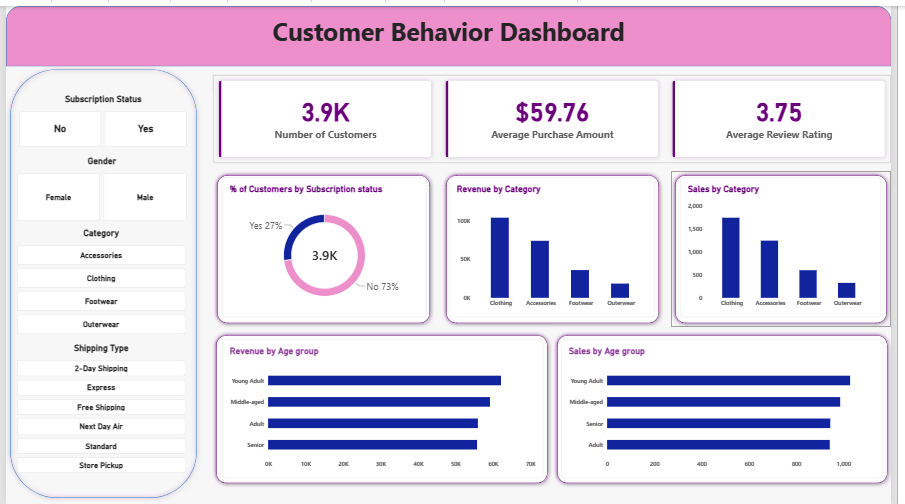

# Customer Shopping Behavior Analysis

End-to-end data analytics project on 3,900 retail transactions ($233K revenue): **Python** for cleaning and EDA, **PostgreSQL** for business analysis, **Power BI** for an interactive dashboard, plus a written report and a Gamma presentation.



---

## Overview

A retailer has detailed purchase records but no clear view of who its best customers are, which products and promotions work, and where to focus marketing. This project answers those questions with data and turns the findings into actionable recommendations.

**Goals**
- Clean and prepare raw customer data
- Create features for segmentation (age groups, purchase frequency, loyalty segments)
- Answer 10 business questions with SQL
- Build an interactive Power BI dashboard
- Deliver a report and presentation with clear recommendations

---

## Dataset

| Item | Detail |
| --- | --- |
| File | `data/customer_shopping_behavior.csv` |
| Size | 3,900 rows, 18 columns |
| Customer | Age, Gender, Location (50 US states), Subscription Status |
| Product | Item Purchased, Category, Size, Color, Season |
| Transaction | Purchase Amount (USD), Review Rating, Payment Method, Shipping Type |
| Behavior | Discount Applied, Promo Code Used, Previous Purchases, Frequency of Purchases |

---

## Tools

| Tool | Purpose |
| --- | --- |
| Python (pandas, SQLAlchemy, psycopg2) | Data loading, EDA, cleaning, feature engineering |
| PostgreSQL | Data storage and SQL analysis (CTEs, window functions, subqueries) |
| Power BI | Dashboard with KPI cards, charts and slicers |
| Gamma | Project presentation |
| GitHub | Version control and portfolio |

---

## Steps

1. **Load and explore (EDA):** inspected structure, data types, summary statistics and missing values.
2. **Clean the data:**
   - Filled 37 missing review ratings (0.95%) with the median rating of each category
   - Standardized column names to snake_case
   - Dropped `promo_code_used`, which was identical to `discount_applied`
3. **Engineer features:**
   - `age_group` using quartiles: Young Adult (18-31), Adult (32-44), Middle-aged (45-57), Senior (58-70)
   - `purchase_frequency_days` converted from labels such as Weekly or Quarterly
4. **Load into PostgreSQL** with SQLAlchemy as the `customer` table.
5. **Analyze with SQL:** 10 business questions on revenue, discounts, subscriptions, shipping, loyalty and products (see `sql/Customer.sql`).
6. **Build the dashboard** in Power BI.
7. **Report and presentation:** summarized findings and recommendations.

---

## Dashboard

The single-page Power BI dashboard includes:
- **KPI cards:** number of customers, average purchase amount, average review rating
- **Charts:** revenue and customers by category and by age group, subscriber split
- **Slicers:** gender, category, subscription status, shipping type

File: `dashboard/customer_behavior-dashboard.pbix` (open with Power BI Desktop)

---

## Results

| Finding | Detail |
| --- | --- |
| Revenue is volume-driven | Men bring 67.7% of revenue because they are 68% of customers; spend per order is nearly equal ($59.54 vs $60.25) |
| Subscriptions do not lift spend | Subscribers average $59.49 vs $59.87 for non-subscribers |
| Discounts are heavily used | 43% of orders; discounted orders average $59.28 vs $60.13 without a discount |
| Top discounted products | Hat 50.0%, Sneakers 49.7%, Coat 49.1% of sales |
| Express shipping | Orders are 3.4% larger than Standard ($60.48 vs $58.46) |
| Strong loyalty | 80% of customers have more than 10 previous purchases |
| Category mix | Clothing and Accessories bring 76.5% of revenue |
| Untapped subscribers | 72% of repeat buyers (2,518 of 3,476) are not subscribed |

**Recommendations:** redesign subscription perks, reduce blanket discounts, target loyal non-subscribers, promote express upgrades, and focus campaigns on Young Adults and Clothing/Accessories.

> **Limitations:** the data has no purchase dates, so trends over time are not measured, and the small differences between groups were not tested for statistical significance.

---

## Project Structure

```text
customer-shopping-behavior-analysis/
├── data/
│   └── customer_shopping_behavior.csv
├── notebooks/
│   └── Customer_Shopping_Analysis.ipynb
├── sql/
│   └── Customer.sql
├── dashboard/
│   └── customer_behavior-dashboard.pbix
├── report/
│   └── Project_Report.pdf
├── images/
│   └── dashboard.png
└── README.md
```

---

## How to Run

**Prerequisites:** Python 3.9+, PostgreSQL, Power BI Desktop

1. **Clone the repository**
   ```bash
   git clone https://github.com/<your-username>/customer-shopping-behavior-analysis.git
   cd customer-shopping-behavior-analysis
   ```
2. **Install dependencies**
   ```bash
   pip install pandas sqlalchemy psycopg2-binary jupyter
   ```
3. **Create a database** in PostgreSQL named `customer_behavior`.
4. **Set your database password** as an environment variable (never commit passwords):
   ```bash
   export DB_PASSWORD="your_password"        # macOS/Linux
   setx DB_PASSWORD "your_password"          # Windows
   ```
   Then read it in the notebook with `os.environ["DB_PASSWORD"]`.
5. **Run the notebook** `notebooks/Customer_Shopping_Analysis.ipynb` to clean the data and load the `customer` table.
6. **Run the SQL queries** in `sql/Customer.sql` using pgAdmin or `psql`.
7. **Open the dashboard** `dashboard/customer_behavior-dashboard.pbix` in Power BI Desktop and refresh the data source if prompted.

> Using MySQL or SQL Server instead? Change the SQLAlchemy connection string (for example `mysql+pymysql://` or `mssql+pyodbc://`) and replace the PostgreSQL-specific cast `review_rating::numeric` with `CAST(review_rating AS DECIMAL(10,2))`.

---

## Report and Presentation

- Project report: [`report/Project_Report.pdf`](report/Project_Report.pdf)
- Presentation (Gamma): [View slides](https://gamma.app/) <!-- replace with your Gamma link -->

---

## Skills Demonstrated

Data cleaning · Exploratory data analysis · Feature engineering · SQL (CTEs, window functions, subqueries) · Dashboard design · DAX · Customer segmentation · Business storytelling

---

## Author

**Your Name**
[LinkedIn](https://www.linkedin.com/) · [GitHub](https://github.com/) · meetsakhiya189@gmail.com
